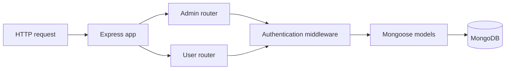

# Course Management API

**A compact Express and MongoDB exercise for learning routes, middleware, and data relationships.**

The API separates administrator and user workflows. Administrators can create and list courses; users can register, browse courses, and associate purchased courses with their account.

## Why this project

A course catalog is a practical way to study how request handling, authentication middleware, and database models fit together. This repository keeps those responsibilities in a small number of files so the flow is easy to trace.

## Implemented routes

| Method | Path | Responsibility |
| --- | --- | --- |
| POST | `/admin/signup` | Create an administrator |
| POST | `/admin/courses` | Create a course through admin middleware |
| GET | `/admin/courses` | List courses through admin middleware |
| POST | `/user/signup` | Create a user |
| GET | `/user/courses` | List courses |
| POST | `/user/courses/:courseId` | Add a course to a user's purchases |
| GET | `/user/purchasedCourses` | Return a user's purchased courses |

## Local setup

Download and extract the repository. Use Node.js, npm, and a MongoDB instance that you control.

Before running, review these source-level setup issues:

- The connection string is hard-coded in `db/index.js`; replace it with your own local development configuration. Do not rely on the committed connection details.
- `router/admin.js` imports `../middleware/Admin`, while the tracked filename is `middleware/admin.js`. Correct the casing on case-sensitive filesystems.
- `index.js` imports `body-parser`, but it is not a direct dependency in `package.json`. Declare the dependency or use the existing `express.json()` middleware consistently when repairing the setup.

The declared start command is:

```bash
npm install
npm start
```

The server listens on `http://localhost:3001`.

## Example request

Once the local setup is configured:

```bash
curl http://localhost:3001/user/courses
```

The response contains a `courses` array from MongoDB. Course creation and purchase requests require the corresponding authentication middleware to accept the request.

## Architecture



## Source guide

| Path | Purpose |
| --- | --- |
| [index.js](index.js) | App setup and port |
| [router](router) | Admin and user handlers |
| [middleware](middleware) | Header-based authentication checks |
| [db/index.js](db/index.js) | Connection and Admin, User, Course schemas |

## Current scope

This is a learning implementation. Passwords are stored as plain strings, authentication is based on request headers, and a purchase records a database association rather than processing a payment. The test script is a placeholder. These boundaries need redesign before deploying a real account or commerce service.

Package metadata declares ISC; the previous README mentioned MIT, but no separate license file is present to resolve that inconsistency.
